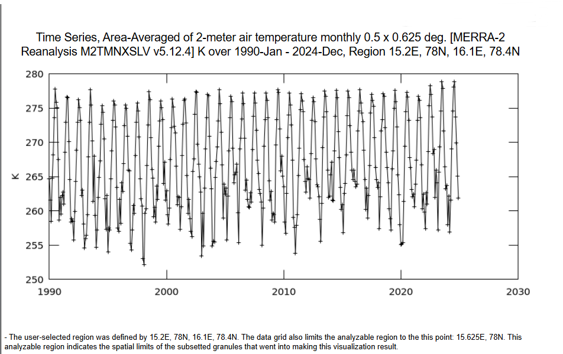

# 🌍 Earth Trend Detective

> **NASA Space Apps Challenge Project**  
> *An interactive STEM web application empowering students and budding climate scientists to investigate Earth science time series, remove seasonal cycles, and test whether climate trends are statistically significant.*

---

## 🛰️ Architecture & Tech Stack

Earth Trend Detective is designed with a modern decoupled full-stack architecture:

1. **Frontend (`frontend/`):**
   - **Framework:** React 19 + Vite
   - **Styling:** Tailwind CSS v4 (Dark space/earth cosmic theme, subtle starfield, glassmorphism)
   - **Animation:** Framer Motion (animated metric count-ups, tab transitions, interactive detective wizard)
   - **Charts:** Plotly (`plotly.js-dist-min` + `react-plotly.js` dual subplots for raw series and deseasonalized anomalies)
   - **Mapping:** Leaflet (`react-leaflet` interactive coordinate picker with pulsing marker)
   - **Typography:** Inter & JetBrains Mono

2. **Backend (`api.py`):**
   - **Framework:** FastAPI + Uvicorn
   - **CORS:** Enabled for `http://localhost:5173`
   - **In-Memory Cache:** Bounded LRU caching for NASA POWER requests
   - **Endpoints:**
     - `GET /api/variables` — Variable catalog with units and student definitions
     - `GET /api/presets` — Curated geographic biomes
     - `GET /api/demos` — 3 guided case studies with story context
     - `POST /api/analyze` — Deseasonalized anomalies, Theil-Sen slope, 95% CI, Mann-Kendall $p$-value, verdict, and optional GPM satellite validation overlay
     - `POST /api/compare` — Comparative trend analysis between two locations with `opposite_trends` flag
     - `GET /api/validation/precip` — Validation benchmark comparing NASA POWER MERRA-2 and NASA Giovanni GPM IMERG satellite precipitation

3. **Core Python Analytics Engine:**
   - `data.py` — NASA Langley POWER API client (AG community, monthly/point endpoint, month 13 & -999 fill sanitization)
   - `analysis.py` — Seasonal cycle removal, `pymannkendall.hamed_rao_modification_test` (autocorrelation-corrected), `scipy.stats.theilslopes`, verdict synthesis
   - `variables.py` — Parameter definitions (`T2M`, `PRECTOTCORR`, `RH2M`, `ALLSKY_SFC_SW_DWN`, `WS10M`, `GWETROOT`)
   - `presets.py` — Biome presets and guided demo scenarios
   - `app.py` — Classic Streamlit user interface (maintained for standalone execution)

---

## ⚡ Quick Start & Run Instructions

> [!TIP]
> **Python Environment Note:**  
> Use your Python virtual environment (e.g. `.\.venv\Scripts\Activate.ps1` on Windows or `source .venv/bin/activate` on Linux/macOS) or call the Python interpreter directly.

### 1. Start the FastAPI Backend

Open a terminal in the project root:

```powershell
# Activate virtual environment if available:
.\.venv\Scripts\Activate.ps1

# Start FastAPI with Uvicorn:
uvicorn api:app --reload --port 8000

# Or via python -m:
python -m uvicorn api:app --reload --port 8000
```

The backend API will start at: `http://127.0.0.1:8000`  
Interactive Swagger docs: `http://127.0.0.1:8000/docs`

---

### 2. Start the Modern React Frontend

Open a second terminal window:

```powershell
cd frontend
npm install
npm run dev
```

The React frontend will be live at: **`http://localhost:5173`**  
*(Vite proxies `/api` calls directly to `http://127.0.0.1:8000`)*

---

### 3. Alternative: Run the Streamlit Interface

If you wish to run the standalone Streamlit app:

```powershell
streamlit run app.py

# Or via python -m:
python -m streamlit run app.py
```

---

## 🚀 Deployment

### Environment Variables

| Location | Variable | Purpose |
| :--- | :--- | :--- |
| Backend (`.env` / Render) | `FRONTEND_ORIGIN` | Deployed frontend URL added to FastAPI CORS (e.g. `https://earth-trend-detective.vercel.app`). Leave blank during local dev. |
| Frontend (`frontend/.env` / Vercel/Netlify) | `VITE_API_URL` | Base URL of the deployed FastAPI backend, **no trailing slash** (e.g. `https://earth-trend-detective-api.onrender.com`). Leave blank for local dev (Vite proxy handles it). |

> Copy `.env.example` → `.env` (repo root) and `frontend/.env.example` → `frontend/.env`, fill in values, and **never commit `.env`** (already in `.gitignore`).

---

### Option A — Render (FastAPI backend)

1. Push the repo to GitHub.
2. In [Render](https://render.com) → **New → Web Service** → connect your repo.
3. Render auto-detects `render.yaml`; confirm the settings:
   - **Build command:** `pip install -r requirements.txt`
   - **Start command:** `uvicorn api:app --host 0.0.0.0 --port $PORT`
4. Under **Environment**, set `FRONTEND_ORIGIN` to your deployed frontend URL.
5. Click **Deploy** — the API will be live at `https://<your-service>.onrender.com`.

---

### Option B — Vercel / Netlify (React frontend)

**Vercel:**
```powershell
cd frontend
npx vercel --prod
# Set environment variable during setup:
#   VITE_API_URL = https://<your-render-service>.onrender.com
```

**Netlify:**
```powershell
cd frontend
npm run build        # outputs to frontend/dist/
# Upload dist/ via Netlify UI or netlify deploy --dir=dist
# Set env var: VITE_API_URL = https://<your-render-service>.onrender.com
```

After the frontend is deployed, copy its URL back to Render's `FRONTEND_ORIGIN` and trigger a redeploy to complete CORS wiring.

---

## 🌟 Application Features & Navigation

| Tab | Feature Highlights |
| :--- | :--- |
| **🔍 1. Investigate** | Left control panel with variable select, student-friendly guide cards, preset biome chips, year slider (1981–2025), Leaflet map coordinate picker, 4 animated metric cards with count-up numbers (Theil-Sen slope, 95% CI, Hamed-Rao $p$-value, significance status), dual-row Plotly chart (raw series vs. deseasonalized anomalies + Theil-Sen fit + 95% CI envelope), color-coded formatted verdict card, and instant CSV export. |
| **⚖️ 2. Compare** | Pick two locations simultaneously for the same parameter with year slider (1981–2025). Shows side-by-side metric cards, verdicts, an overlaid comparison chart, and a prominent alert banner when **opposite trends** are detected (e.g., one location warming while another cools). |
| **🚀 3. Guided Demos** | 3 curated case studies: Arctic Amplification (Svalbard), Sahel Rainfall Recovery, and Great Plains Wind Stability (illustrating when natural variability dominates). Features live computed Theil-Sen slope and Hamed-Rao $p$-value metrics, one-click loading directly into the Investigate tab, and in-place live preview. |
| **🕵️ 4. Data Detective** | 3-step animated interactive diagnostic wizard: picks environment, Earth sphere (including terrestrial Water cycle), and climate topic, recommends a tailored mystery mission, and loads it into Tab 1 with a single click. |
| **📚 5. Methodology** | Explains the science of seasonal cycle subtraction, Hamed-Rao autocorrelation-corrected Mann-Kendall rank statistics, Theil-Sen median slope vs. OLS regression, $p$-values, and critical limitations (linearity, point sampling, NASA MERRA-2 model reanalysis). |

---

## 📁 Repository Structure

```
Nasa-space-apps/
├── api.py                  # FastAPI REST backend (CORS enabled for localhost:5173)
├── frontend/               # Modern React + Vite frontend application
│   ├── src/
│   │   ├── api.js          # REST client communicating with FastAPI
│   │   ├── components/     # Navbar, MapPicker, MetricCards, PlotlyChart, VerdictCard, SkeletonLoader
│   │   ├── views/          # InvestigateView, CompareView, DemosView, DetectiveView, MethodologyView
│   │   ├── App.jsx         # Main application controller and tab routing
│   │   ├── main.jsx        # Entrypoint
│   │   └── index.css       # Tailwind CSS v4 & space cosmic theme
│   ├── index.html          # HTML shell with Inter font & Leaflet styling
│   ├── vite.config.js      # Vite configuration with Tailwind plugin & /api proxy
│   └── package.json        # Frontend dependencies
├── data/
│   └── precipitation_gpm_monthly.csv # NASA Giovanni GPM IMERG satellite precipitation benchmark
├── validation/
│   ├── giovanni_svalbard_t2m.csv     # NASA Giovanni Svalbard temperature benchmark dataset
│   └── validation_giovanni_svalbard.png
├── data.py                 # NASA POWER API client & GPM IMERG reader
├── analysis.py             # Trend statistics (Hamed-Rao Mann-Kendall & Theil-Sen slope) & verdict generator
├── variables.py            # Variable definitions & units
├── presets.py              # Biomes, demo scenarios, detective logic
├── plots.py                # Plotly figure generator
├── app.py                  # Standalone Streamlit interface
├── test_core.py            # Automated end-to-end Python test suite
├── requirements.txt        # Backend dependencies (fastapi, uvicorn, pydantic, etc.)
└── README.md               # Documentation & setup instructions
```

---

## 🔬 Scientific Methodology Summary

1. **Seasonal Deseasonalizing:** $\text{Anomaly}(m, y) = X(m, y) - \bar{X}_m$, eliminating the annual $23.5^{\circ}$ axial tilt oscillation.
2. **Autocorrelation-Corrected Mann-Kendall Test:** Uses `pymannkendall.hamed_rao_modification_test` (Hamed & Rao, 1998). Climate time series exhibit physical persistence (positive autocorrelation), which underestimates standard Mann-Kendall variance and produces false positives. The Hamed-Rao modification calculates an effective sample size $n^*$ across significant autocorrelation lags, preventing spurious trends and ensuring robust statistical significance ($\alpha = 0.05$).
3. **Theil-Sen Robust Slope:** Median of all pairwise slopes $\beta = \text{median}\left(\frac{x_j - x_i}{t_j - t_i}\right)$, providing 29% breakdown resilience against extreme weather outliers.
4. **95% Confidence Interval:** Computed via `scipy.stats.theilslopes` and scaled to units per decade ($\times 10$).

---

---

## 🛰️ Data Credits

- **Data Source:** NASA POWER, derived from MERRA-2 reanalysis (NASA GMAO).
- **Data Provider:** [NASA Langley Research Center POWER Project](https://power.larc.nasa.gov/) (Prediction Of Worldwide Energy Resources, AG Community)
- **Atmospheric Model:** NASA GMAO MERRA-2 (Modern-Era Retrospective analysis for Research and Applications, Version 2)
- **Event:** Built for the NASA Space Apps Challenge (Student & High School STEM Educational Track)
- *Notice:* Each external site's data terms apply.

---

## 🔬 Scientific Validation

To verify the analytical rigor of our trend calculation and autocorrelation-corrected test, our pipeline was benchmarked against two independent satellite retrievals from **NASA Giovanni**:

1. **Surface Air Temperature (T2M) Benchmark:**
   Cross-validated against MERRA-2 monthly surface air temperature product `M2TMNXSLV` at Svalbard (15.625°E, 78.0°N):

   

   > **Caption:** Svalbard T2M trend, 1990-2024: +0.69 °C/decade (95% CI +0.50 to +0.88) in our tool vs +0.687 °C/decade (95% CI +0.50 to +0.88) computed from NASA Giovanni (MERRA-2 M2TMNXSLV, same grid cell at 15.625E, 78N). Both significant. Data: `validation/giovanni_svalbard_t2m.csv` in the repo.

2. **Precipitation Satellite Benchmark (GPM IMERG):**
   Cross-validated against the Global Precipitation Measurement (GPM) monthly satellite-gauge product `GPM_3IMERGM_07` (2000–2024, Svalbard area average 15.2°E–16.1°E, 78.0°N–78.4°N):
   - Monthly raw correlation: $r = 0.81$
   - Deseasonalized anomaly correlation: $r = 0.77$
   - Both datasets confirm consistent variability and agree that precipitation fluctuations remain within natural inter-annual variability ($p \ge 0.05$).
   - Data: `data/precipitation_gpm_monthly.csv` in the repo, integrated via optional validation overlay on the API and frontend.

---

## 📚 References & Further Tools

Authoritative portals, platforms, and technical literature for cross-examining Earth observation data and statistical methods *(Note: Each external site's data terms apply)*:

- [NASA Giovanni](https://giovanni.gsfc.nasa.gov/) — Web-based environment for interactive analysis, visualization, and exploration of NASA Earth science satellite and reanalysis data.
- [NASA Hydrology Time Series](https://disc.gsfc.nasa.gov/information/tools?title=Hydrology%20Time%20Series) — Online portal for point and regional extraction of multi-mission hydrological time series and land-surface model outputs.
- [NOAA Climate Data Online](https://www.ncei.noaa.gov/cdo-web/) — National Centers for Environmental Information repository providing free access to global historical weather station observations.
- [KNMI Climate Explorer](https://climexp.knmi.nl/) — Statistical research workbench for climate researchers to correlate, verify, and perform time-series analysis on global datasets.
- [Statistical test methods to detect trends in time series data](https://medium.com/@snp.kriss/statistical-test-methods-to-detect-trends-in-time-series-data-b361a0ec530b) — Comprehensive technical overview of parametric vs. non-parametric methods, Mann-Kendall formulation, and Sen's slope estimator.
- [A Comprehensive Guide to Statistical Significance](https://www.statsig.com/perspectives/a-comprehensive-guide-to-statistical-significance) — Pedagogical introduction to hypothesis testing, null hypotheses, p-values, confidence bounds, and Type I/II errors.
- [Time-Series Analysis of Remotely-Sensed SeaWiFS Chlorophyll in River-Influenced Coastal Regions](https://ntrs.nasa.gov/api/citations/20090042747/downloads/20090042747.pdf) — NASA technical publication detailing deseasonalizing methodologies and non-parametric monotonic trend detection on satellite time series.

### Seminal Mathematical Citations

- **Mann, H. B. (1945):** Nonparametric tests against trend. *Econometrica*, 13(3), 245–259.
- **Kendall, M. G. (1975):** *Rank Correlation Methods*. 4th edition, Charles Griffin, London.
- **Sen, P. K. (1968):** Estimates of the regression coefficient based on Kendall's tau. *Journal of the American Statistical Association*, 63(324), 1379–1389.
- **Hamed, K. H., & Rao, A. R. (1998):** A modified Mann-Kendall trend test for autocorrelated data. *Journal of Hydrology*, 204(1–4), 182–196.

---

## 🤖 Super Intelligence (SI) Disclosure

This project was developed with SI assistance:
- Code: the FastAPI backend, React frontend and Streamlit prototype were generated and refined with Google Antigravity (AI coding agent) and Anthropic's Claude, then reviewed, tested and run by the team.
- Text: the README, in-app explanations and Methodology wording were drafted with AI assistance and edited by the team.
- Data and analysis: NASA POWER/MERRA-2 data is real NASA data. All trend statistics (Theil-Sen, Hamed-Rao Mann-Kendall) were validated by us against NASA Giovanni output.
No NASA logos or branding are used.

---

## ⚖️ Disclaimer

Data: NASA POWER, derived from MERRA-2 reanalysis (NASA GMAO). Built for the NASA Space Apps Challenge. NASA does not endorse this project or any non-U.S. Government entity, and is not responsible for information on non-U.S. Government websites.

*Each external site's data terms apply.*
